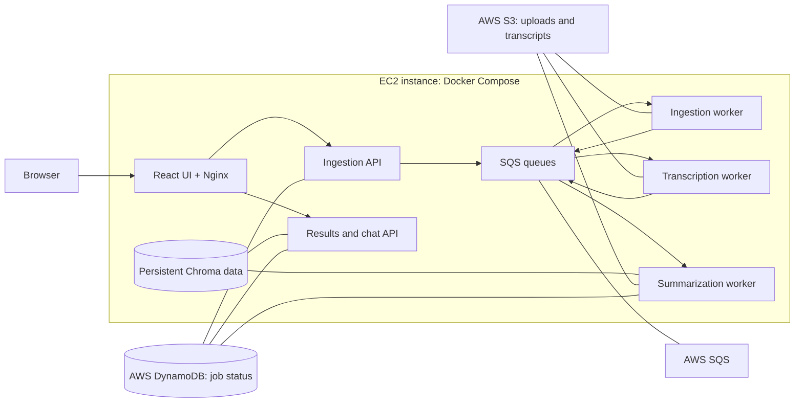

# VideoSense — AI Video Assistant

Paste a YouTube link or upload a video to get a transcript, summary, action items, key facts, and questions. You can also chat with the video using transcript-based retrieval.

## Architecture

For the cloud deployment, Docker Compose runs the app containers on one Amazon EC2 instance. The app uses real S3, DynamoDB, and SQS resources in AWS. An EC2 instance profile supplies AWS credentials; access keys are not stored in the containers. ChromaDB and the Whisper model cache use persistent EC2 volumes.



The workers handle audio ingestion, transcription, then summarization and indexing. Kubernetes is not used. Local development can optionally use LocalStack, but the AWS deployment uses real AWS services.

## Deploy to AWS

1. Create the AWS data services and the EC2 instance role:

   ```bash
   aws cloudformation deploy --template-file aws-resources.yml --stack-name videosense --capabilities CAPABILITY_NAMED_IAM
   aws cloudformation describe-stacks --stack-name videosense --query "Stacks[0].Outputs" --output table
   ```

2. Launch an Ubuntu EC2 instance as `t3a.large` (2 vCPU, 8 GiB RAM) and attach the `AppRoleName` from the stack outputs. Use a 30 GiB gp3 root disk. Select **Standard** CPU credits to avoid T-series surplus-credit charges; transcription may run more slowly when CPU credits run low. Use the instance's public IP directly: allow HTTP on port 80 and SSH only from your own IP, and skip a load balancer and NAT gateway. For Docker containers to obtain the instance role credentials, set the instance metadata response hop limit to `2` and require IMDSv2. AWS notes that a hop limit of `1` can prevent containers from receiving instance metadata credentials.

3. Install Docker Engine and the Compose plugin, clone this repository on the instance, and create a project-root `.env` file:

```env
MISTRAL_API_KEY=your-mistral-api-key
SARVAM_API_KEY=your-sarvam-api-key
AWS_REGION=ap-south-1
JOBS_BUCKET=videosense-jobs-ACCOUNT_ID-ap-south-1
```

Set `JOBS_BUCKET` to the `JobsBucketName` output from CloudFormation. Then start the app:

```bash
docker compose up -d --build
```

Open the EC2 instance’s public address over HTTP. The UI is served on port 80 and proxies API requests to the backend containers. LocalStack is not part of this deployment.

The first start builds the images and downloads the Whisper model. Docker volumes retain the model cache and Chroma index when containers restart.

### Keep the AWS bill low

- Start the EC2 instance only when testing or presenting, then **stop** it afterward. Stopping it ends compute charges; its 30 GiB disk and stored S3 objects remain billable.
- The `t3a.large` Mumbai on-demand rate is about `$0.0493/hour`. The example 30 GiB gp3 disk is about `$2.74/month`; compute for a 10-hour demo month is about `$0.49`. If left on all month, compute, disk, and its public IPv4 address total about `$42/month`. S3, DynamoDB, and SQS add usage-based charges. These estimates exclude taxes and Mistral/Sarvam API usage.
- Delete test jobs in the app when you no longer need them; this removes their S3 objects and DynamoDB rows.
- AWS new-account credits may offset eligible charges. Check the Billing console for your account’s credit balance and set a budget alert before launching resources.

When the project is finished, terminate the EC2 instance, delete the CloudFormation stack, then remove the retained bucket and table. Use the `JobsBucketName` output for the bucket name:

```bash
aws cloudformation delete-stack --stack-name videosense
aws cloudformation wait stack-delete-complete --stack-name videosense
aws s3 rb s3://YOUR_JOBS_BUCKET_NAME --force
aws dynamodb delete-table --table-name videosense-jobs
```

## Run locally

```bash
docker compose -f docker-compose.yml -f docker-compose.local.yml up --build
```

Create `.env` with `MISTRAL_API_KEY` (and optionally `SARVAM_API_KEY`) first. Open [http://localhost](http://localhost). The local override starts LocalStack and routes the app to its emulated S3, DynamoDB, and SQS services. Stop the stack with `docker compose -f docker-compose.yml -f docker-compose.local.yml down`; add `-v` only to erase saved local jobs and indexes.

## Configuration

| Variable | Purpose | Default |
|---|---|---|
| `MISTRAL_API_KEY` | Summaries, embeddings, and chat | Required |
| `SARVAM_API_KEY` | Hindi transcription | Optional |
| `WHISPER_MODEL` | Local Whisper model size | `small` |
| `WHISPER_DEVICE` | `cpu` or `cuda` | `cpu` |
| `SARVAM_STT_MODEL` | Sarvam speech model | `saaras:v3` |

The AWS deployment gets credentials from the EC2 role. Local development gets dummy credentials and a LocalStack endpoint from `docker-compose.local.yml`.

## API

| Method | Endpoint | Description |
|---|---|---|
| `POST` | `/api/upload` | Upload a video or audio file (up to 500 MB). |
| `POST` | `/api/process` | Start processing a YouTube URL or uploaded file. |
| `GET` | `/api/process/{id}/status` | Check job progress. |
| `GET` | `/api/process/{id}/results` | Get the completed analysis. |
| `POST` | `/api/process/{id}/ask` | Ask a question about the video. |
| `GET` | `/api/jobs` | List past jobs. |
| `DELETE` | `/api/jobs/{id}` | Delete a job and its data. |

## Project structure

```text
services/       FastAPI APIs and the three pipeline workers
shared/         Job state, object storage, queue, and API models
tests/          Backend tests
UI/             React + Vite frontend, Nginx proxy, and UI image
docker-compose.yml  AWS app containers
docker-compose.local.yml  Optional LocalStack development services
aws-resources.yml  AWS S3, DynamoDB, SQS, and EC2 role
Dockerfile.*    Backend service images
```

## Tests

```bash
python -m pytest
```

Tests use Moto to emulate AWS services and require `ffmpeg` for audio processing cases.
