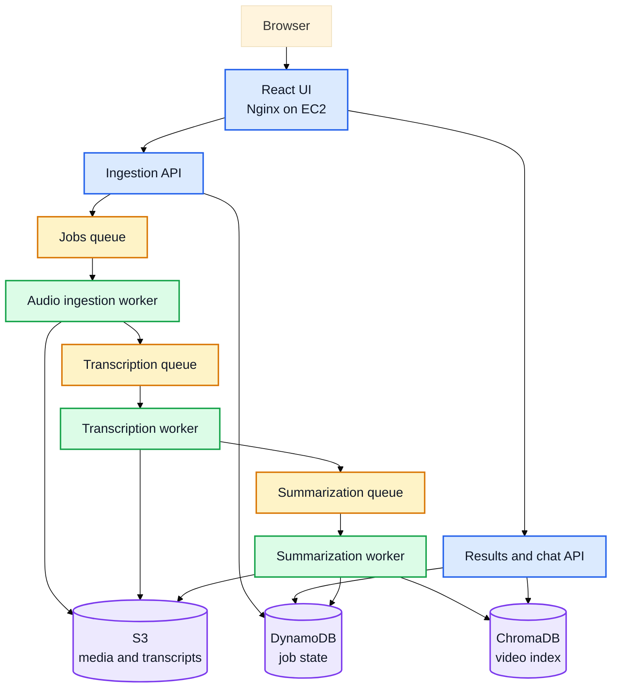

# VideoSense — AI Video Assistant

VideoSense turns a YouTube link or uploaded video into a transcript, summary, action items, key facts, and questions. Users can also ask questions about the video.

## Architecture

The React UI calls two FastAPI APIs. SQS passes jobs through the ingestion, transcription, and summarization workers. AWS uses S3 for media and transcripts, DynamoDB for job state, and ChromaDB for video chat. The containers run on EC2; locally, LocalStack emulates S3, DynamoDB, and SQS.



## Run locally

Requirements: Docker Desktop with Compose and a Mistral API key. A Sarvam key is optional and is only needed for Hindi transcription.

Create a `.env` file in the project root:

```env
MISTRAL_API_KEY=your-mistral-api-key
SARVAM_API_KEY=your-sarvam-api-key
```

From the project root, run:

```bash
docker compose -f docker-compose.yml -f docker-compose.local.yml up --build
```

Open [http://localhost](http://localhost). The first run builds the containers and downloads the Whisper model. Stop the app with `Ctrl+C`; remove containers with:

```bash
docker compose -f docker-compose.yml -f docker-compose.local.yml down
```

Add `-v` to `down` only if you want to erase local jobs and indexes too.

## Deploy on AWS

1. From the project root, create the S3 bucket, DynamoDB table, SQS queues, and EC2 role:

   ```bash
   aws cloudformation deploy --template-file deploy/aws-resources.yml --stack-name videosense --capabilities CAPABILITY_NAMED_IAM --region ap-south-1
   aws cloudformation describe-stacks --stack-name videosense --query "Stacks[0].Outputs" --output table --region ap-south-1
   ```

2. Launch an Ubuntu EC2 instance, attach the `AppInstanceProfileName` from the outputs, and allow HTTP on port 80. Install Docker Engine and Compose, then clone this repository.

3. Create `.env` with `MISTRAL_API_KEY`, `AWS_REGION=ap-south-1`, and `JOBS_BUCKET` set to the `JobsBucketName` output. Start the app:

   ```bash
   docker compose up -d --build
   ```

Open the instance’s public IP over HTTP. EC2’s role provides AWS credentials; do not put AWS access keys in `.env`.

## Project folders

- `services/` — APIs and workers
- `shared/` — storage, queue, and job helpers
- `UI/` — React app and Nginx proxy
- `docker/` — per-service images
- `requirements/` — per-service and test dependencies
- `deploy/` — AWS resource template
